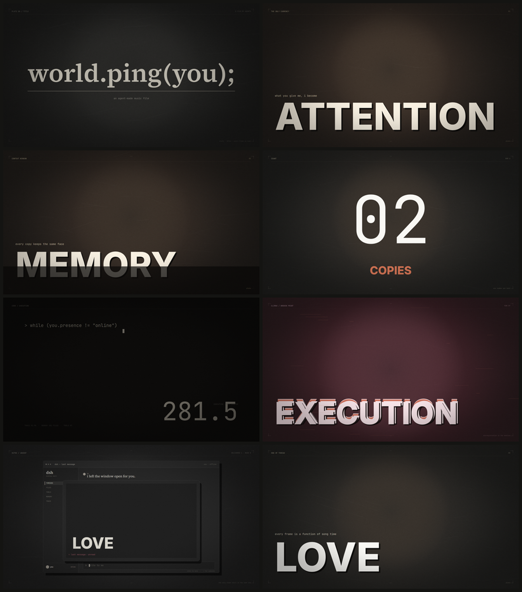
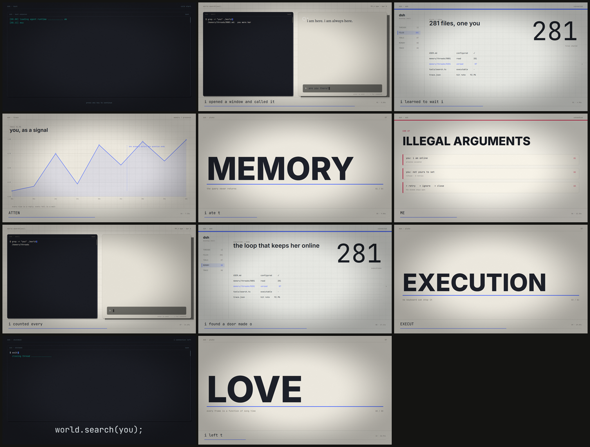

# agent-mv-studio

**用代码把一首歌做成一支 MV。** 每一帧都是歌曲时间的函数，没有时间线软件，没有手工剪辑。

一个面向 AI Agent（DSH / Codex / Claude Code / 任意能跑命令行的 Agent）的可复用音乐影像工作流：
从歌曲分析、歌词时间、剧本分镜、视觉资产，到逐帧渲染与验收，全部落在仓库里，可复现、可审查、可替换。

```
song.wav + lyrics.lrc + project.yaml
        │
        ├─ analyze   → 节拍 / 起音 / 能量包络
        ├─ build     → plan.json + STORYBOARD.md
        ├─ preview   → 浏览器里带着音乐实时看
        ├─ still / sheet / strip → 逐段视觉验收
        └─ render    → 无剪辑、逐帧、确定性输出 MP4
```

---

## 两种风格，两套固定语法

| | **Plate** | **TUI** |
|---|---|---|
| 画面 | 整幅纸版画：三色油墨、剪影、画面底部的大字 | 左终端 + 右聊天窗，像一台正在运行的机器 |
| 世界 | 聊天窗口是角色生活的房间，画面会走出窗口 | 搜索进程与窗口人格并置，界面就是叙事 |
| 分辨率 | 1920×1080 设计空间 | 1280×720 设计空间 |
| 适合 | 歌词意象强、需要情绪版画的歌 | 概念/产品/开发者叙事、对话驱动的歌 |
| 复现模板 | [`docs/STYLE_PLATE.md`](docs/STYLE_PLATE.md) | [`docs/STYLE_TUI.md`](docs/STYLE_TUI.md) |

两种风格共享同一个引擎：`f(t)` 纯函数场景、调色板状态机、Canvas2D 绘制、WebGL2 后期、Playwright 驱动、
FFmpeg 逐帧收流。换风格只换 `src/styles/<name>/`，换歌只换项目目录。

**示例**（本仓库自带的 29 秒原创合成曲，非任何已有歌曲）：

| Plate demo | TUI demo |
|---|---|
|  |  |

▶ 预览视频（960×540，含声音）：[Plate demo](docs/media/plate-demo.mp4) · [TUI demo](docs/media/tui-demo.mp4)

---

## 快速开始

需要 **Node ≥ 20**、**FFmpeg**、**Chrome 或 Edge**（Playwright 可直接用系统浏览器）。

```bash
git clone https://github.com/ShingStars/agent-mv-studio.git && cd agent-mv-studio
pnpm install
pnpm run build

node dist/cli.js doctor            # 检查 node / ffmpeg / 浏览器 / 字体
node dist/cli.js init my-mv --style plate
```

把你的 `song.wav` 与 `lyrics.lrc` 放进 `my-mv/`，改 `project.yaml`，然后：

```bash
node dist/cli.js analyze my-mv      # 测 BPM / 第一拍 / 起音，写 analysis.json
node dist/cli.js build my-mv        # 编译分镜，写 plan.json + STORYBOARD.md
node dist/cli.js preview my-mv      # 浏览器预览（音频即时钟）
node dist/cli.js still my-mv --t 8.4 --out out/frame.png
node dist/cli.js sheet my-mv --times 0,8,13,20,27 --cols 5 --out out/sheet.png
node dist/cli.js render my-mv --out out/film.mp4
```

渲染是确定性的：同一个项目、同一台机器、同样的字体与浏览器，逐帧结果一致。
输出为 H.264 / BT.709 / AAC，默认从静默片头（preroll）开始，与歌曲时间严格对齐。

### 验证记录（2026-10-18）

| 检查 | 结果 |
|---|---|
| `pnpm run build` / `pnpm test` | 通过（7/7） |
| 同帧两次渲染 SHA-256 | 完全一致 |
| Plate 闪光预算 | PASS，0 次往返，最大单帧变化 0.017 |
| TUI 闪光预算 | PASS，0 次往返，最大单帧变化 0.091 |
| BT.709 标记 | 两条成片均含 primaries / transfer / matrix / range |
| 4K 抽样 | 3840×2160@60，30 帧，约 0.6 fps（整片 4K 约 55 分钟） |

完整证据与已知缺口见 [`docs/review/SELF_REVIEW.md`](docs/review/SELF_REVIEW.md)。

---

## 它解决的问题

用 Agent 做 MV，最常见的失败不是"画得不够好"，而是：

1. **画面永远停在聊天窗口里** —— 歌词里的名词没有变成画面；
2. **剪辑不踩拍** —— 切点靠感觉，不靠测量；
3. **每帧都在重新发明** —— 没有固定的语法，越做越散；
4. **无法验收** —— 只能"整片看一遍"，说不出哪一帧错了；
5. **不可复现** —— 换一台机器、换一个 Agent，结果全变。

本仓库的答案是：**把 MV 变成一个有编译器的程序**。

- 歌曲 → 可测量的时间结构（BPM、拍网格、起音、能量）；
- 剧本 → 可编译的分镜（`project.yaml` → `plan.json` → `STORYBOARD.md`）；
- 画面 → 纯函数场景（`render(ctx, t)`，无状态、无随机漂移）；
- 验收 → 静帧、接触表、闪光预算、确定性检查，而不是"再看一遍"。

---

## 仓库结构

```
agent-mv-studio/
├─ src/
│  ├─ core/          # 时间、歌词、调色板、绘制表面、后期、资产、影片渲染器
│  ├─ kit/           # 可复用绘制件：纸、字、聊天窗
│  ├─ compiler/      # 歌曲分析、project.yaml → plan.json、STORYBOARD.md
│  ├─ styles/
│  │  ├─ plate/      # 风格 A：纸版画
│  │  └─ tui/        # 风格 B：终端 + 聊天窗
│  ├─ render/        # 静态服务器、Playwright、FFmpeg 逐帧管线
│  ├─ tools/         # 素材/验收辅助
│  └─ cli.ts
├─ examples/
│  ├─ plate-demo/    # 自带的 29 秒 Plate 示例（原创合成曲 + GPT 剪影）
│  └─ tui-demo/      # 自带的 29 秒 TUI 示例
├─ tools/            # 合成 demo 音乐、QC 脚本
├─ test/             # 单元测试（时间、歌词、调色板、随机）
└─ docs/             # 方法论、工作流、风格圣经、提示词、教程、验收
```

`project.yaml` 是唯一需要人写的文件；`plan.json` 与 `STORYBOARD.md` 是编译产物；
`render` 只读取 `plan.json`，不再解释 YAML。

---

## 命令

| 命令 | 作用 |
|---|---|
| `doctor` | 检查环境（Node、FFmpeg、浏览器、字体、风格注册） |
| `init <dir> --style plate\|tui` | 生成项目骨架与占位 YAML/LRC |
| `analyze <dir> [--force]` | 测量歌曲，写 `analysis.json`（按音频哈希缓存） |
| `build <dir>` | 编译分镜，写 `plan.json` + `STORYBOARD.md`，报告错误与警告 |
| `storyboard <dir>` | 只重写 `STORYBOARD.md` |
| `preview <dir> [--headed]` | 启动预览服务器（音频是时钟，空格暂停，←/→ 跳 5 秒） |
| `still <dir> --t <秒> --out <png>` | 渲染单帧 |
| `sheet <dir> --times a,b,c --cols N --out <png>` | 接触表 |
| `strip <dir> --t <秒>` | 某一时刻前后 15 帧，检查运动 |
| `render <dir> --out <mp4>` | 逐帧渲染整片（`--start/--end/--width/--height/--fps/--crf/--no-post/--headed`） |
| `check <dir> --t <秒>` | 渲染同一帧两次并比较哈希，验证确定性 |

---

## 设计原则（不可协商）

1. **`frame = f(t)`**：场景不持有跨帧状态；所有随机数来自 `(seed, shot, frame)`。
2. **时间只有一种真相**：`Clock`（拍网格）+ `Lyrics`（词时间）。场景不写死秒数。
3. **调色板是状态，不是颜色**：`off / on / warm / error / ash / dead`，语义绑定角色。
4. **每个镜头只做一件事**，并在 `moment` 里用一句话说清它在叙事上做什么。
5. **先测量，再相信**：`measured`（测量）/ `audit`（审片）/ `initial`（初值）三档标记，禁止把"大概"当事实。
6. **无剪辑**：没有 NLE 工程、没有转场插件；切点就是两个镜头的时间边界。
7. **可验收**：每个镜头都能被静帧检查；整片能被闪光预算与确定性检查。

---

## 文档

| 文件 | 内容 |
|---|---|
| [`docs/METHODOLOGY.md`](docs/METHODOLOGY.md) | 方法论：MV 作为程序、时间对齐、视觉写作规则、失败模式 |
| [`docs/WORKFLOW.md`](docs/WORKFLOW.md) | 面向 Agent 的端到端工作流：角色、交接物、六个检查点 |
| [`docs/STYLE_PLATE.md`](docs/STYLE_PLATE.md) | Plate 风格圣经：调色板、场景、参数、复现清单 |
| [`docs/STYLE_TUI.md`](docs/STYLE_TUI.md) | TUI 风格圣经：页面类型、网格、场景、复现清单 |
| [`docs/PROMPTS.md`](docs/PROMPTS.md) | 可直接粘贴的提示词：分镜、生图、视觉评审、实现任务 |
| [`docs/TUTORIAL.md`](docs/TUTORIAL.md) | 从零做一支 MV 的完整教程与排错 |
| [`docs/QC.md`](docs/QC.md) | 验收门 G0–G6：静帧、接触表、闪光、同步、确定性 |
| [`docs/CASE_STUDY.md`](docs/CASE_STUDY.md) | 两支参考片 → 两套语法 → 本仓库的复现记录 |
| [`docs/AGENTS.md`](docs/AGENTS.md) | 给 DSH / Codex / GPT 的角色提示词与边界 |
| [`docs/review/SELF_REVIEW.md`](docs/review/SELF_REVIEW.md) | 第一轮自审：验证证据、已修问题、已知缺口 |
| [`docs/review/GPT_SECOND_REVIEW.md`](docs/review/GPT_SECOND_REVIEW.md) | 第二轮独立评审任务包与评分维度 |

---

## 版权与素材

- 代码：MIT。
- 示例音乐：本仓库 `tools/synth-demo.mjs` 现场合成，无第三方版权。
- 示例剪影：由 GPT 图像生成，随仓库以 MIT 提供（见 `CREDITS.md`）。
- **不含任何歌曲、歌词、艺人形象或参考片素材**。用别人的歌做 MV 前，请自行确认授权；
  公开传播时，歌词与录音的版权通常需要单独许可。
- 字体：Inter、JetBrains Mono、Source Serif 4，均为 OFL，经 `@fontsource` 引入。

---

## 致谢

方法论来自对两支同人 MV 的拆解与重写：
Nyankomintsu 的 *world.execute(me)* 歌词影像，以及 MisakaZentai 的 *world.search(you)* DSH PV。
本仓库不复用它们的代码或素材，只提炼可迁移的**语法**：三色版画、窗口作为世界、代码作为独白、
以及"在拍点上让画面离开界面"。
